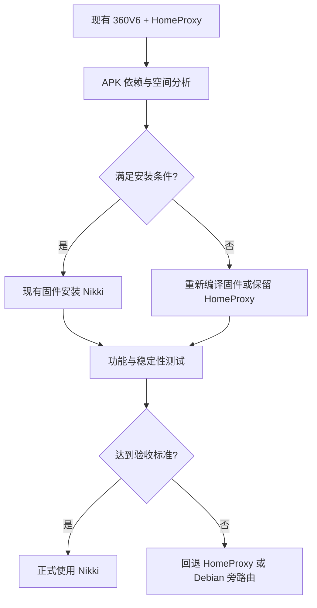

# 360V6：HomeProxy 迁移 Nikki 可行性分析方案

> 目标：优先在现有 LibWrt 固件上进行只读分析和安装模拟，确认资源与依赖兼容性后，再决定是否迁移或重新编译固件。

## 1. 当前设备基线

| 项目 | 实际检测结果 |
|---|---|
| 设备 | 360V6 |
| 固件 | LibWrt 25.12-SNAPSHOT r0-6c363ce |
| Target | qualcommax/ipq60xx |
| 固件软件包架构 | aarch64_cortex-a53 |
| APK 报告架构 | aarch64 |
| 内核 | 6.12.116 |
| 包管理器 | APK |
| 总内存 | 374.83 MiB |
| 可用内存 | 约 126.31 MiB |
| ZRAM Swap | 187 MiB，未使用 |
| SquashFS | 27.5 MiB，只读 |
| Overlay 总容量 | 44.8 MiB |
| Overlay 实际可用 | 41.4 MiB |
| sing-box 二进制 | 39.9 MiB，内置于 `/rom/usr/bin/sing-box` |
| sing-box RSS | 56.62 MiB |
| HomeProxy | 已安装，疑似固件内置 |
| Mihomo / yq | 检测未发现 |
| IPv6 | 当前不使用 |
| NSS / ECM | 已加载 |
| OOM | 未发现 |

### 初步结论

- 内存具备运行精简 Nikki 配置的基础条件，但长期稳定性仍需实测。
- 直接卸载固件内置 sing-box 不会释放其在只读 SquashFS 中的空间，反而可能产生 Overlay 删除标记。
- 目前最大不确定因素是 Nikki 及其依赖的 UBIFS 实际占用、APK 软件源可用性和内核 ABI 兼容性。
- 187 MiB ZRAM 不是额外的物理 RAM。
- 停止 HomeProxy 后可回收部分进程内存，但 RSS 并不等于可回收内存。

## 2. 候选部署方案

| 方案 | 实施方式 | 优先级 |
|---|---|---|
| A | 保留 HomeProxy，确认依赖和空间后安装 Nikki，切换时停止 HomeProxy | 优先验证 |
| B | 重新编译 LibWrt，移除 HomeProxy / sing-box，内置 Nikki / Mihomo | 长期推荐 |
| C | Mihomo 内核放在 `/tmp` | 仅短期测试，占用 RAM |
| D | 继续使用 HomeProxy | 回退方案 |
| E | Debian Mihomo 旁路由 | 路由器资源不足时采用 |



## 3. 第一阶段：固件与可释放空间分析

以下命令仅用于检测或模拟，不实际卸载软件。

### 3.1 检查软件包信息及固件内置文件

```sh
for pkg in luci-app-homeproxy luci-i18n-homeproxy-zh-cn sing-box; do
    echo "===== $pkg ====="
    apk info -s "$pkg"
    apk info -L "$pkg"
    apk info -r "$pkg"
done

ls -lh /rom/usr/bin/sing-box /rom/usr/bin/mihomo /rom/usr/bin/yq 2>/dev/null
ls -ld /rom/www/luci-static/resources/view/homeproxy /rom/etc/init.d/homeproxy 2>/dev/null
```

检查文件是否位于 `/rom`，区分固件预置内容和 Overlay 新增内容。

### 3.2 检查 UBI 和 Overlay

```sh
cat /proc/mtd
ubinfo -a

df -h
mount | grep -E 'overlay|ubifs|squashfs'
du -ak /overlay/upper 2>/dev/null | sort -rn | head -30
```

关注 UBI 卷分配、剩余擦除块、Overlay 文件分布。若系统没有 `ubinfo`，记录该项为待查，不必为了检测强行安装软件。

### 3.3 模拟卸载

```sh
apk del --simulate luci-app-homeproxy luci-i18n-homeproxy-zh-cn sing-box
```

APK 报告的逻辑释放空间不能当成实际闪存释放量。不要执行真实卸载，保留原插件作为回退手段。

## 4. 第二阶段：Nikki APK 软件包分析

官方仓库：https://github.com/nikkinikki-org/OpenWrt-nikki

官方 Feed 脚本：https://github.com/nikkinikki-org/OpenWrt-nikki/blob/main/feed.sh

当前固件为 LibWrt 25.12-SNAPSHOT，不能仅根据 OpenWrt 版本相近就认定软件包兼容。

### 4.1 检查官方 Feed 脚本

```sh
WORKDIR=/tmp/nikki-analysis
mkdir -p "$WORKDIR/keys" "$WORKDIR/cache"

wget -O "$WORKDIR/feed.sh" \
    https://github.com/nikkinikki-org/OpenWrt-nikki/raw/refs/heads/main/feed.sh

cat "$WORKDIR/feed.sh"
cat /etc/openwrt_release
apk --print-arch
cat /etc/apk/repositories.d/* 2>/dev/null
```

先阅读脚本，核对实际的软件源路径、签名公钥 URL、版本匹配和架构映射。不要直接将远程脚本管道传给 `ash`。

以下路径为上一版方案的候选值，尚未实机核验，若官方脚本不同，应以实际官方脚本为准。

### 4.2 使用临时密钥及仓库

```sh
cp -a /etc/apk/keys/. "$WORKDIR/keys/"

wget -O "$WORKDIR/keys/nikki.pem" \
    https://nikkinikki.pages.dev/public-key.pem

. /etc/openwrt_release
NIKKI_REPO="https://nikkinikki.pages.dev/openwrt-25.12/${DISTRIB_ARCH}/nikki/packages.adb"

napk() {
    apk --keys-dir "$WORKDIR/keys" \
        --cache-dir "$WORKDIR/cache" \
        --repository "$NIKKI_REPO" "$@"
}

napk update
```

以上命令不主动永久添加 Nikki 软件源。`apk update` 可能刷新索引；临时缓存选项是否完全隔离系统缓存，以当前 APK 实现为准。若下载或签名验证失败，停止并检查，不要使用 `--allow-untrusted`。

现有系统输出已有多个 APK 缓存索引缺失警告，应先确认 LibWrt 对应仓库仍然可用，不要混用不匹配的发行版或内核包。

### 4.3 查询安装大小与依赖

```sh
for pkg in mihomo-meta nikki luci-app-nikki luci-i18n-nikki-zh-cn \
    yq ip-full kmod-inet-diag kmod-nft-socket kmod-nft-tproxy \
    kmod-tun kmod-dummy; do
    echo "===== $pkg ====="
    napk info -s "$pkg"
    napk info -R "$pkg"
done
```

包名需根据实际仓库索引核对。如果某个包名不存在，不要强行安装。

### 4.4 模拟安装

```sh
napk add --simulate --verbose \
    mihomo-meta nikki luci-app-nikki luci-i18n-nikki-zh-cn
```

验收条件：

- [ ] ARM64 对应包存在且签名验证成功。
- [ ] Nikki、Mihomo、LuCI、yq 依赖均可解析。
- [ ] kmod 与当前内核 ABI 一致。
- [ ] 无基础系统库危险替换或跨版本升级。
- [ ] 模拟安装成功。

如遇 `unsatisfiable constraints`、`unable to select packages`、内核 ABI 冲突等错误，停止安装，不绕过依赖或签名检查。

## 5. 第三阶段：存储空间预算

当前 Overlay 实际可用 41.4 MiB（以 `df -h /overlay` 为准，而不是用总容量减已用容量简单计算）。

| 用途 | 建议预算 |
|---|---:|
| 软件安装及依赖 | 26.4 MiB |
| 精简规则与缓存 | 5 MiB |
| 系统配置及运行余量 | 5 MiB |
| 更新预留 | 5 MiB |
| 合计 | 41.4 MiB |

示例预算（非实测）：Mihomo 15 MiB、yq 4 MiB、Nikki + LuCI 1 MiB、其他依赖 2 MiB、规则 5 MiB，共 27 MiB，剩余约 14.4 MiB。这里是假设的 **UBIFS 实际占用**，不是已验证的软件包体积。

计算公式：

```text
安装后剩余 = 41.4 - Mihomo实际占用 - yq实际占用
             - Nikki及LuCI实际占用 - 其他依赖实际占用 - 规则及缓存
```

APK 下载大小、解包逻辑大小与 UBIFS 实际占用不能互相等同。模拟安装不能准确预测闪存压缩率。建议最终保留至少 10 MiB，理想为 15 MiB 或以上；升级可能需要额外临时空间。

## 6. 第四阶段：测量 HomeProxy 内存占用

通过局域网 SSH 操作，以下停止服务步骤会暂时中断代理。

### 6.1 停止前

```sh
grep -E 'MemAvailable|MemFree|Cached|SwapFree' /proc/meminfo

for pid in $(pidof sing-box); do
    grep -E 'VmRSS|VmHWM|VmSwap' /proc/$pid/status
    if [ -r "/proc/$pid/smaps_rollup" ]; then
        grep -E '^Rss:|^Pss:|^Private_' /proc/$pid/smaps_rollup
    fi
done
```

### 6.2 停止后

```sh
/etc/init.d/homeproxy stop
sleep 10

grep -E 'MemAvailable|MemFree|Cached|SwapFree' /proc/meminfo
pidof sing-box
df -h /overlay
```

### 6.3 恢复

```sh
/etc/init.d/homeproxy start
```

| 指标 | 停止前 | 停止后 |
|---|---:|---:|
| MemAvailable | 126.31 MiB | 待测 |
| sing-box RSS | 56.62 MiB | 待确认进程已退出 |
| sing-box PSS | 待测 | 待测 |
| Swap 使用 | 0 | 待测 |

## 7. 第五阶段：安装和运行测试

先完成第 3、4、5 节评估，并按第 9 节备份。只有依赖和空间风险可控后才进行实际安装。

实际安装应使用已经核验的官方 Feed 配置和签名公钥。保留 HomeProxy 软件与配置，切换前停止并禁用其自启动，不同时运行两套透明代理。

### 7.1 推荐低资源运行配置

Mihomo 配置片段（不是完整可直接启动的配置）：

```yaml
ipv6: false
mode: rule
log-level: warning
find-process-mode: off
geodata-loader: memconservative
geodata-mode: false
tcp-concurrent: false

tun:
  enable: false

profile:
  store-selected: true
  store-fake-ip: false
```

| 项目 | 推荐测试配置 |
|---|---|
| 节点 | us-dmit-reality |
| TCP 透明代理 | Redirect |
| UDP 透明代理 | TPROXY |
| TUN | 关闭 |
| IPv6 代理 | 关闭 |
| DNS | Fake-IP |
| 国内 DNS | 223.5.5.5、119.29.29.29 |
| 分流规则 | 按需使用 MRS 规则集 |
| Apple / 微信 / 国内域名及 IP | DIRECT |
| 默认流量 | 代理 |
| 防火墙层绕过中国 IP | 初期关闭，之后按性能与统计需求决定 |
| 控制面板 | 外置 MetaCubeXD |
| 历史统计 | PVE / Debian 上的 Neko Master |

需要按照 Nikki 的 Mixin 和实际配置检查监听端口、DNS 劫持、规则组及节点；避免多个服务同时劫持 DNS。绕过中国 IP 后，未进入 Mihomo 的流量无法通过 Clash API 统计。

### 7.2 DNS 与功能验收

| 测试项目 | 预期 |
|---|---|
| 国内网站 | DIRECT |
| Apple App Store / iCloud | DIRECT |
| 微信及小程序 | DIRECT |
| Google / YouTube / Telegram / ChatGPT | PROXY |
| 局域网访问 | 正常 |
| DNS 劫持与指定设备绕过 | 符合配置 |
| UDP / QUIC | 符合节点支持能力 |
| Clash API / MetaCubeXD | 正常 |
| Neko Master | 正常采集进入 Mihomo 的连接 |
| 重启后服务 | 自动恢复 |

针对此前有问题的域名：

```text
mini-app-api.eloccitane.com
mini-app-image.eloccitane.com
```

从客户端检查 DNS 解析、连接目标、规则命中及实际出口。Fake-IP 模式下返回的虚拟 IP 不等于最终连接目标地址，需要结合 Mihomo 连接记录验证。国内 DNS 也不能保证一定返回国内 CDN 地址。

NSS / ECM 应单独测试：对比国内外吞吐量、CPU 使用率和 Clash API 连接统计；如果怀疑硬件加速导致流量绕过，应先确认规则和连接路径，再针对性调整，不盲目卸载驱动。

### 7.3 资源监控脚本

在 HomeProxy 和 Nikki 两种模式下分别执行，保留各自 CSV 文件进行对比。默认最多采集 72 小时，每 30 秒一次。

```sh
cat > /tmp/proxy-monitor.sh <<'SCRIPT'
#!/bin/sh
INTERVAL="${1:-30}"
SAMPLES="${2:-8640}"
LOG="${3:-/tmp/proxy-performance.csv}"

case "$INTERVAL" in ''|*[!0-9]*|0) exit 1;; esac
case "$SAMPLES" in ''|*[!0-9]*|0) exit 1;; esac

echo 'time,mem_available_kb,swap_used_kb,sing_box_rss_kb,mihomo_rss_kb,load1,connections,overlay_available_kb' > "$LOG"

get_rss() {
    local name="$1" total=0 rss pid
    for pid in $(pidof "$name"); do
        rss=$(awk '/^VmRSS:/ {print $2}' "/proc/$pid/status" 2>/dev/null)
        total=$((total + ${rss:-0}))
    done
    echo "$total"
}

n=0
while [ "$n" -lt "$SAMPLES" ]; do
    now=$(date '+%Y-%m-%d %H:%M:%S')
    mem=$(awk '/^MemAvailable:/ {print $2}' /proc/meminfo)
    swap=$(awk '/^SwapTotal:/ {t=$2} /^SwapFree:/ {f=$2} END {print t-f}' /proc/meminfo)
    sb=$(get_rss sing-box)
    mh=$(get_rss mihomo)
    load=$(awk '{print $1}' /proc/loadavg)
    conn=$(cat /proc/sys/net/netfilter/nf_conntrack_count 2>/dev/null)
    disk=$(df -k /overlay | awk 'END {print $4}')
    echo "$now,$mem,$swap,$sb,$mh,$load,${conn:-NA},$disk" >> "$LOG"
    tail -n 1 "$LOG"
    n=$((n+1))
    [ "$n" -lt "$SAMPLES" ] && sleep "$INTERVAL"
done
SCRIPT
chmod +x /tmp/proxy-monitor.sh
```

例如分别测试 24 小时：

```sh
# HomeProxy 模式
/tmp/proxy-monitor.sh 30 2880 /tmp/homeproxy-performance.csv

# 切换 Nikki 后再运行
/tmp/proxy-monitor.sh 30 2880 /tmp/nikki-performance.csv
```

按 Ctrl+C 可提前停止。日志在 `/tmp` 中，重启前及时导出。

### 7.4 稳定性验收标准

以下是建议阈值，不是 Nikki 官方硬件最低要求。

| 指标 | 理想 | 可接受 | 风险 |
|---|---|---|---|
| MemAvailable | ≥100 MiB | 60–100 MiB | 持续低于 60 MiB |
| ZRAM 使用 | 0–10 MiB | 10–50 MiB | 持续增长或伴随性能下降 |
| Overlay 剩余 | ≥15 MiB | 10–15 MiB | 低于 10 MiB |
| OOM | 0 | 0 | 任何 OOM |
| 内核退出 | 0 | 0 | 反复重启 |
| DNS | 正常 | 少量可解释异常 | 持续失败 |
| 国内访问性能 | 接近基线 | 轻微下降 | 明显下降 |

```sh
dmesg | grep -Ei 'out of memory|oom-kill|killed process'
logread | grep -Ei 'nikki|mihomo|oom|out of memory' | tail -100
cat /proc/swaps
df -h /overlay
```

建议覆盖空闲、日常上网、高清视频、大文件下载、多设备并发及 24–72 小时稳定性测试。

## 8. 第六阶段：重新编译固件

如果空间不足、依赖无法解析或内核 ABI 不兼容，则重新编译 LibWrt。

### 8.1 移除旧组件

```ini
# CONFIG_PACKAGE_luci-app-homeproxy is not set
# CONFIG_PACKAGE_luci-i18n-homeproxy-zh-cn is not set
# CONFIG_PACKAGE_sing-box is not set
```

### 8.2 添加 Nikki Feed

在 `feeds.conf.default` 中添加（正式构建建议固定 commit）：

```text
src-git nikki https://github.com/nikkinikki-org/OpenWrt-nikki.git;main
```

```sh
./scripts/feeds update -a
./scripts/feeds install -a
```

### 8.3 集成 Nikki 及依赖

```ini
CONFIG_PACKAGE_nikki=y
CONFIG_PACKAGE_mihomo-meta=y
CONFIG_PACKAGE_luci-app-nikki=y
CONFIG_PACKAGE_luci-i18n-nikki-zh-cn=y
CONFIG_PACKAGE_yq=y
CONFIG_PACKAGE_ip-full=y
CONFIG_PACKAGE_kmod-inet-diag=y
CONFIG_PACKAGE_kmod-nft-socket=y
CONFIG_PACKAGE_kmod-nft-tproxy=y
CONFIG_PACKAGE_kmod-tun=y
CONFIG_PACKAGE_kmod-dummy=y
```

具体包名以所选 Feed 为准。检查依赖：

```sh
make defconfig
grep -E 'CONFIG_PACKAGE_.*(nikki|mihomo|sing-box|homeproxy|yq)' .config
```

保留现有设备 Target、NSS、无线驱动、分区布局及恢复能力，不要因替换代理组件随意更改这些配置。

### 8.4 三种固件对照实验

| 固件 | 组件 | 目标 |
|---|---|---|
| V1 | HomeProxy + sing-box | 基准 |
| V2 | 无代理插件 | 测量移除后压缩空间差异 |
| V3 | Nikki + Mihomo | 测量替换后净空间差异 |

保持同一个 LibWrt commit、内核、NSS 配置、基础包及压缩参数。

比较 SquashFS 镜像大小、软件包清单、UBI 卷布局及刷机后实际 Overlay 可用空间。SquashFS 变小不一定意味着 Overlay 同比例增大；应以 UBI 分配和实际 `df` 为准。

刷机前检查设备对应镜像、校验和、备份及恢复方式，不在未确认兼容性的情况下刷机。

## 9. 安全备份与回退

在实际修改系统之前执行：

```sh
umask 077
sysupgrade -b /tmp/360v6-backup.tar.gz
uci export homeproxy > /tmp/homeproxy-backup.uci
apk info > /tmp/packages-before.txt
nft list ruleset > /tmp/nftables-before.txt
ip rule show > /tmp/ip-rules-before.txt
ip route show table all > /tmp/ip-routes-before.txt
```

将备份下载到电脑。备份可能包含代理节点、密码等敏感内容，妥善保存。

若 Nikki 运行异常，通过局域网 SSH 回退：

```sh
/etc/init.d/nikki stop
/etc/init.d/nikki disable
/etc/init.d/homeproxy enable
/etc/init.d/homeproxy start
```

检查服务和网络是否恢复：

```sh
pidof mihomo
pidof sing-box
ip rule show
nft list ruleset
logread | tail -100
```

如果 Nikki 停止后仍有残留规则，应根据备份及插件日志排查，避免直接 `nft flush ruleset`，以免破坏路由器防火墙。

## 10. 执行检查清单

- [ ] 检查 ROM 与 Overlay 文件分布。
- [ ] 检查 UBI 卷和剩余擦除块。
- [ ] 模拟卸载 HomeProxy，确认不会误判释放空间。
- [ ] 核对 Nikki 官方 Feed 脚本及签名公钥。
- [ ] 查询 APK 包大小和依赖。
- [ ] 模拟安装并检查内核 ABI。
- [ ] 测量 HomeProxy 停止后可用内存。
- [ ] 确认实际空间预算。
- [ ] 将现有配置备份到电脑。
- [ ] 安装 Nikki 并迁移节点和分流规则。
- [ ] 测试 DNS、NSS、ECM 和透明代理。
- [ ] 测试 MetaCubeXD 与 Neko Master。
- [ ] 完成 24–72 小时稳定性测试。
- [ ] 决定是否重新编译 LibWrt 固件。

## 11. 最终决策原则

1. 模拟安装通过、空间预算可控：优先尝试现有固件迁移。
2. 安装后 Overlay 余量不足或 ABI 不兼容：重新编译固件。
3. 长期内存压力过大或硬件加速受影响：回退 HomeProxy，或将 Mihomo 移至 Debian 旁路由。
4. 不必先卸载固件内置 HomeProxy 或 sing-box；直接卸载不能释放只读固件空间。

## 12. 参考资料及未验证事项

- [Nikki 官方仓库](https://github.com/nikkinikki-org/OpenWrt-nikki)
- [Nikki Wiki](https://github.com/nikkinikki-org/OpenWrt-nikki/wiki)
- [Nikki Releases](https://github.com/nikkinikki-org/OpenWrt-nikki/releases)
- [HomeProxy](https://github.com/immortalwrt/homeproxy)
- [Mihomo 文档](https://wiki.metacubex.one/)
- [Neko Master](https://github.com/foru17/neko-master)

本文根据用户提供的 SSH 检测结果及上一轮分析方案整理。临时软件源路径、公钥 URL、软件包名称、实际安装占用、内核 ABI、NSS/ECM 行为及长期稳定性均需实机验证。空间预算和验收阈值为建议值，不是已测结果。本文没有实际执行安装、卸载或刷机操作。
